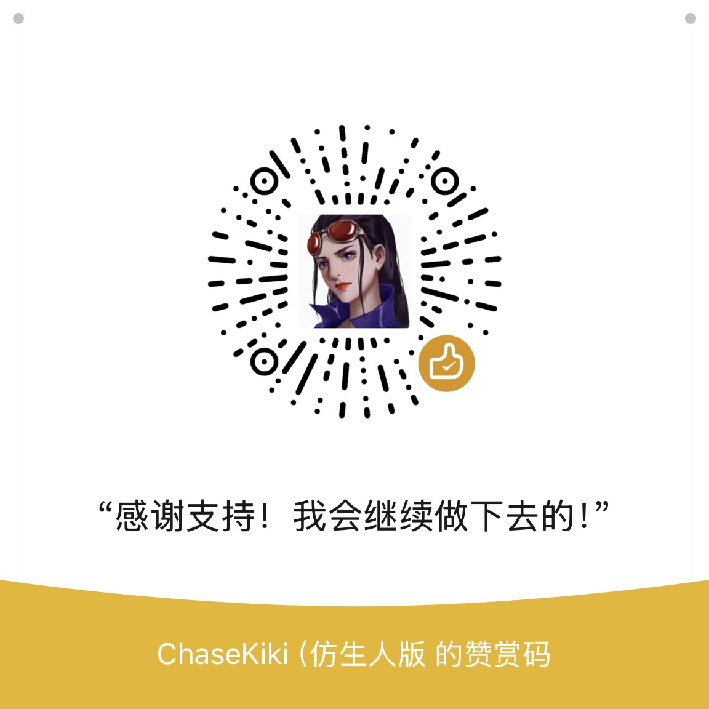

# PSD2UGUI-Codex

[简体中文](README.md) | [English](README.en.md)

**Turn layered Photoshop designs into editable Unity uGUI prefabs, with Codex-assisted recognition, grouping and component binding.**

Ordinary layer names, including Chinese names, are supported. Current release: **Preview**, internal version `2026.10.30-preview.11`. Review generated layouts and interactions before using them in production.

- [Download the Unity package](Releases/preview.11/PsdTool-2026.10.30-preview.11.unitypackage)
- [English user guide](Assets/PsdTool/Documentation/UserGuide.en.md)
- [Chinese user guide](Assets/PsdTool/Documentation/使用说明.md)
- [MIT License](LICENSE)

## Who it helps

For teams using **layered PSDs and uGUI**, especially projects with many screens and frequent design revisions. Evaluate integration costs first if your project has few screens or an established alternative pipeline.

- **Artists:** less rule-based naming, repetitive slicing and explanation of part ownership. Deliver sensible groups, separate component parts and font information; Unity helper hierarchies are generated by the tool.
- **UI engineers:** less manual positioning, hierarchy assembly and reference wiring. Focus on reviewing suggestions, resolving ambiguous parts, validating interactions and implementing business logic.
- **During revisions:** change previews, stable mappings and property locks reduce repeated assembly and rebinding. Existing references still need verification.
- **Teams:** visual review, isolated issues and configurable resource paths support a consistent workflow. MIT-licensed source can be adapted for commercial and closed-source projects.

The need comes from repetitive work across design handoff and iteration. AI recognition and incremental updates also exist in other tools. This project focuses on a **low naming burden, reviewable changes and source-level customization**; it makes no benchmarked accuracy or time-saving percentage claim.

## Features

- Parse layered PSD images, text, positions and hierarchy into editable uGUI prefabs. Layout defaults favor preserving the design rather than guessing responsive anchors.
- Use page/region images, numbered layer sheets and structure data to propose control types, part ownership and virtual groups. New groups use English names.
- Build Button, Toggle, ScrollView, Dropdown, InputField, Slider and Progress controls with their required hierarchy and references.
- Review suggestions beside PSD thumbnails, apply individual plans, and explicitly override supported markings. Diagnosable control failures can fall back to visual output while other controls continue; issues remain in the report.
- Update incrementally using source mappings, previews and property locks to protect existing scripts, events and manual edits.
- Configure resource output paths, image reuse, nine-slice checks, atlases and Android/iOS settings for new textures.
- Use visual bounds for button hit areas and native ScrollRect view/content proportions for scrollbar handles. Progress supports manually configured linear or radial fill.
- Optionally bake image-layer FX through a temporary Photoshop document. Text stays editable through TMP, with partial effect approximation.

## Requirements

- Tested: **Windows, Unity 2022.3.62f3c1, uGUI 1.0.0, TextMeshPro 3.0.7**. Other versions and operating systems are not systematically validated.
- Input: **layered PSD**, with independent parts. The parser targets 8-bit RGB PSD/PSB; public validation focuses on PSD. A flattened screenshot cannot restore missing layers or component parts.
- AI is optional and requires the **official Codex CLI**, its own authenticated account, network access and available usage allowance. A ChatGPT browser login alone does not authenticate the CLI. No Ollama, local vision model or separate API key configuration is required by this workflow.
- Photoshop is optional and required for the image FX baking workflow. Supply your own licensed application and fonts; these dependencies and service entitlements are not included.
- **The editor UI is currently primarily Chinese.** English documentation includes the original menu/button labels; full English UI localization is not yet available.

## Quick start

1. Install uGUI and TextMeshPro in an existing Unity project, then import **TMP Essential Resources**.
2. Import the `.unitypackage` using **Assets → Import Package → Custom Package**, or copy `Assets/PsdTool` and its `.meta` files into your project. This repository is not a complete Unity example project or a UPM package.
3. Open **Tools → PSD 工具 → 打开工具**. Configure design resolution, output paths and TMP font mappings; configure Photoshop if image FX are needed.
4. Select a PSD and click **解析 PSD** (Parse PSD).
5. Click **Codex 识别** (Codex recognition). Follow the first-use installation/login prompts and wait for results. Unity starts the CLI and receives its response; advanced options also provide a manual task workflow.
6. Review suggested controls, ownership and structure. Apply the desired plans and generate the prefab. Without AI, select control types and slots manually.
7. Verify the result in a Canvas: appearance, hit areas, selection, dropdown, scrolling and text input. For revisions, reuse the source tree/output location, preview changes, then update incrementally.

## Artist handoff

No naming protocol is required. Use sensible groups and keep backgrounds, text, icons, arrows, checkmarks, tracks and handles as separate layers. Keep list items in individual groups and place dropdown options inside their list. Preserve editable text, provide font information, and save with **Maximize Compatibility** enabled. Artists do not need to create Unity's Viewport, Content or Sliding Area nodes.

See the [user guide](Assets/PsdTool/Documentation/UserGuide.en.md) for control-specific requirements and acceptance checks.

## Limits and data handling

Complex/ambiguous designs still need engineering review. Not all Photoshop effects are reproduced; automatic nested-prefab substitution and business UI binding-code generation are not implemented. A successful prefab save does not prove every interaction is correct. Do not discard metadata, bypass source validation or skip incremental change review.

AI recognition exports screenshots and layer metadata, including names, text, geometry and hierarchy, for processing by the official Codex CLI/service. **This is not fully offline recognition.** Use only artwork you are authorized to process with that service. Authentication is managed by the official CLI; no account credentials, project artwork or local task caches are distributed here.

Runtime code/layout must update Content dimensions when items change so ScrollRect can update its handle correctly. Mobile texture presets do not constitute Android/iOS device validation.

## Source and license

`Assets/PsdTool` contains Editor code, Runtime helpers, Photoshop scripts, the recognition skill and documentation. `Releases/preview.11` contains the verified installer and checksum. Project data, commercial artwork, fonts, local settings and internal test fixtures are excluded.

**MIT License:** free use, modification, distribution, commercial use and integration into closed-source projects are permitted. **Retain the copyright and complete permission notice** when distributing the software or substantial portions of it. Provided as-is, without warranty. See [LICENSE](LICENSE), [third-party notices](THIRD_PARTY_NOTICES.md) and [contributing notes](CONTRIBUTING.md).

This independently maintained project is not affiliated with Unity, Adobe or OpenAI.

## Optional support

If this tool saves you repetitive work, you can support its continued maintenance on [Ko-fi](https://ko-fi.com/chasekiki) or through WeChat.

**Support is entirely voluntary. All features and MIT license rights remain available whether or not you contribute. A tip does not purchase features, priority handling or guaranteed response times.** This is a personally maintained project; bug reports, documentation improvements and sharing your experience are equally appreciated.

WeChat appreciation code (click to expand)

Scan using WeChat. Click the image to open the original.

The repository's Sponsor button also links to [Ko-fi](https://ko-fi.com/chasekiki) and the [support page](docs/support/README.md).
